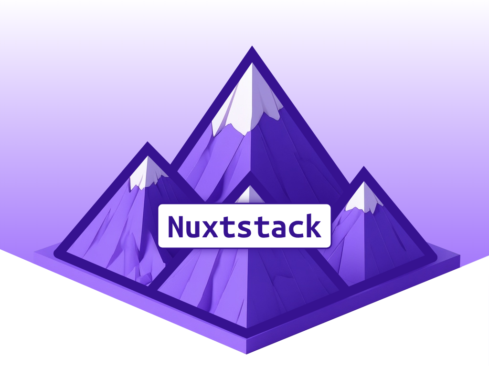

# Nuxtstack



Similar to [MKStack](https://getstacks.dev/stack/naddr1qvzqqqrhl5pzqprpljlvcnpnw3pejvkkhrc3y6wvmd7vjuad0fg2ud3dky66gaxaqqrk66mnw3skx6c4g6ltw), but build upon [Nuxt](https://nuxt.com/) with [Vue](https://vuejs.org/) and Javascript only.

**Nuxstack provides a development framework for Rapid Application Building (RAD).**

Nuxtstack is a development boilerplate/starter template specifically designed for building Nostr applications using modern web technologies. Build Nostr apps in minutes with this comprehensive framework.

## 🎯 Project Overview
 
This is a **development framework** that combines cutting-edge web technologies with Nostr protocol integration, designed for rapid prototyping and AI-assisted development workflows.

## 🛠️ Technology Stack

- **Nuxt**: Progressive Vue.js framework for web applications
- **Vue.js**: Frontend framework with custom element support enabled
- **TailwindCSS**: Utility-first CSS framework with Vite plugin
- **Pinia**: State management for Vue applications
- **Vite**: Build tool and development server
- **JavaScript**: Pure JS implementation (no TypeScript)

## 🚀 Purpose & Target

- **Nostr Application Development**: Build decentralized social applications on the Nostr protocol
- **AI-Assisted Development**: Extensive tooling for AI agents and automated development workflows
- **Rapid Prototyping**: Accelerate Nostr app development with pre-configured tooling

## 📋 Current State

This is a **fresh starter template** with:
- Basic application structure (`App.vue`)
- Footer component template
- Empty directories ready for:
  - Pages (used for routing)
  - Layouts
  - Components
  - Nostr web components inside the Components directory
- Complete build and development pipeline

## 🔧 MCP (Model Context Protocol) Integration

The project includes three configured MCP servers for enhanced AI development:
- **js-dev**: JavaScript development tools
- **nostr**: Nostr protocol specific tools  
- **nuxt**: Nuxt framework specific tools

## ✨ Key Features

1. **Development-Ready**: Complete build pipeline (dev, build, generate, preview)
2. **Nostr-Focused**: Dedicated tooling and components structure for Nostr development
3. **AI-Agent Friendly**: Extensive configuration for automated development workflows
4. **Modern Stack**: Latest versions of Nuxt, TailwindCSS, and supporting tools

## 🚀 Quick Start

```bash
# Install dependencies
npm install

# Start development server
npm run dev

# Build for production
npm run build

# Generate static site
npm run generate

# Preview production build
npm run preview
```

## 🏗️ Project Structure

```
nuxtstack/
├── components/           # Vue components
│   ├── nostr-web-components/  # Nostr-specific components
│   └── Footer.vue       # Example component
├── layouts/             # Nuxt layouts (empty - ready for your layouts)
├── pages/               # File-based routing (empty - ready for your pages)
├── assets/              # Static assets and styles
├── public/             # Static files served directly
├── stores/             # # Pinia stores for state management
├── .mcp.json           # MCP server configuration for AI tools
├── nuxt.config.js      # Nuxt configuration
└── App.vue             # Root application component
```

## 🎯 What You Can Build

This framework is perfect for building:
- Decentralized social media clients
- Nostr-based marketplaces
- Messaging applications
- Content publishing platforms
- Community forums
- Any application leveraging the Nostr protocol

## 📚 Resources

- [Nuxt Documentation](https://nuxt.com/)
- [Nostr Protocol](https://nostr.com/)
- [TailwindCSS Documentation](https://tailwindcss.com/)
- [Vue.js Documentation](https://vuejs.org/)

## 📄 License

MIT License

---

**Ready to build the decentralized web?** Start developing your Nostr application with this modern, AI-friendly framework.
